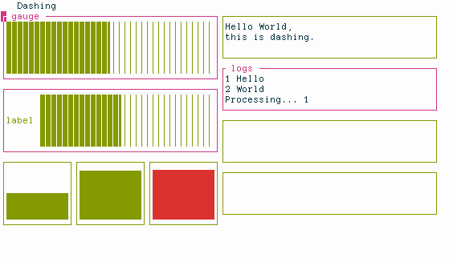

image:https://img.shields.io/badge/status-beta-orange.svg[badge]
image:https://img.shields.io/pypi/v/dashing.svg?style=plastic["Latest Version", link="https://pypi.python.org/pypi/dashing"]
image:https://img.shields.io/badge/License-LGPL%20v3-blue.svg[License]
image:https://api.reuse.software/badge/github.com/FedericoCeratto/dashing[REUSE,link="https://api.reuse.software/info/github.com/FedericoCeratto/dashing"]

Dashing is a library to quickly create terminal-based dashboards in Python.

Similar libraries for other languages: https://github.com/gizak/termui[termui] https://github.com/chjj/blessed[blessed] https://github.com/yaronn/blessed-contrib[blessed-contrib]

Features:

- [x] Sub-character resolution (partially filled blocks)
- [x] Horizontal and vertical bars with gradient coloring
- [x] Text and log panes with automated scrolling
- [x] Automatic scaling of all elements
- [x] Vertical and horizontal tile splitting
- [x] Braille-filled charts
- [x] Theming with 24-bit RGB and HSV colors
- [x] Color gradients

=== Dependencies

The link:https://pypi.python.org/pypi/blessed[blessed] library.

=== Installation

Use packages from your Linux distribution, or:

[source,bash]
----
pip install dashing
----

=== Usage

See the demo at https://github.com/FedericoCeratto/dashing/blob/main/examples/demo.py
and the documentation at https://dashing.readthedocs.io/en/latest/

.Usage
[source,python]
----
# Colors can be "#RRGGBB" (RGB), "*HHSSVV" (HSV) or RGB(r, g, b)
ui = HSplit(
    VSplit(
        HGauge(title="title", color_low="*A000FF", color_high="*A00000"),
        VGauge(border_color="#00ff00", color_low="#0000ff", color_high="#00ffff"),
    ),
    VSplit(
        Text("Hello World,\nthis is dashing.", border_color="#ff0000"),
        Log(title="logs", color_high=RGB(0, 0, 0), color_low=RGB(200, 200, 200)),
        HBrailleFilledChart(),
    ),
    title="Dashing",
)

with open_terminal() as terminal:
    log = ui.items[1].items[1]
    log.append("log line")

ui.display(terminal)

----

=== Development

Use pytest for testing.

`tests/test_integ.py` contains integration tests that runs a simulated terminal and captures the output

Also `minidemo.py` can be used for manual testing.
